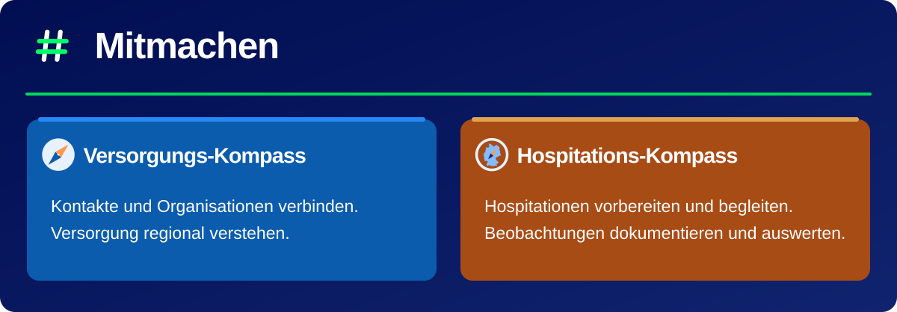

Versorgungsarbeit und Hospitationen gemeinsam organisieren. Der Versorgungs-Kompass verbindet Kontakte und Organisationen mit dem regionalen Versorgungsgeschehen. Der Hospitations-Kompass unterstützt Vorbereitung, Dokumentation und Auswertung von Hospitationen. Beide nutzen gemeinsame Profile und Rollen.

**[Kurzanleitung als PDF](dokumentation/nutzung/Nutzerhandbuch.pdf)** und [bearbeitbare Word-Fassung](dokumentation/nutzung/Nutzerhandbuch.docx). Die bebilderte Anleitung erklärt Versorgungs-Kompass und Hospitations-Kompass auf 15 Seiten. Stand 14. November 2026.

Zielplattform ist **GKE/Kubernetes mit OIDC**. Diese Dokumentation führt vom fachlichen Einstieg bis zur Vorbereitung des Betriebs.

## Die sechs Anleitungen

| Einstieg | Inhalt |
| --- | --- |
| [Anwendung](dokumentation/gematik/ANWENDUNG.md) | Die zwei Kompasse und ihre gemeinsame Grundlage |
| [Architektur und Daten](dokumentation/gematik/ARCHITEKTUR_UND_DATEN.md) | Komponenten, Anmeldung und Datenfluss |
| [Datenschutz und Compliance](dokumentation/gematik/DATENSCHUTZ_UND_COMPLIANCE.md) | Datennutzung und laufender interner Compliance-Check |
| [Entwicklung und QA](dokumentation/gematik/ENTWICKLUNG_UND_QA.md) | Lokal bauen und synthetisch prüfen |
| [Übernahme und Updates](dokumentation/gematik/RELEASE_UND_UPDATES.md) | Quellstand übernehmen und Änderungen nachführen |
| [Betrieb](dokumentation/betrieb-und-deployment/BETRIEB_GEMATIK.md) | Bereitstellung, Abnahme und Wartung |

Quellcode und technische Dokumentation stehen unter [Apache License 2.0](LICENSE). Für Daten und Marken gelten die [Datenhinweise](dokumentation/rechtliches/DATA_NOTICE.md) und [Markenhinweise](dokumentation/rechtliches/NOTICE.md). Sicherheitsmeldungen folgen der [Sicherheitsrichtlinie](SECURITY.md).
